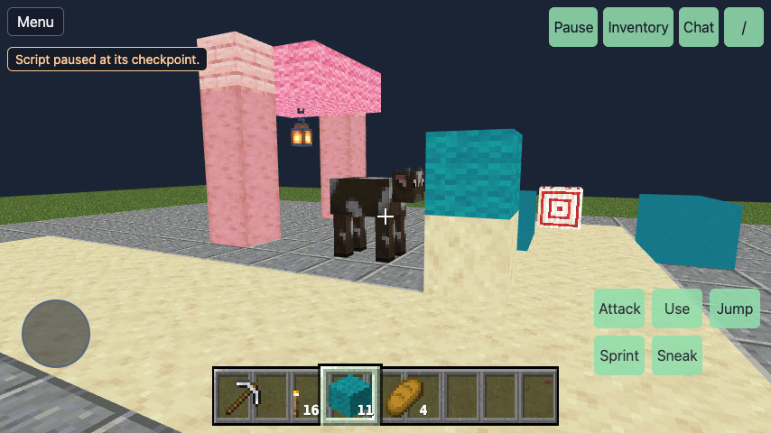
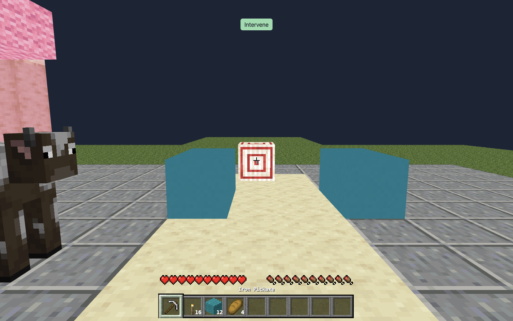
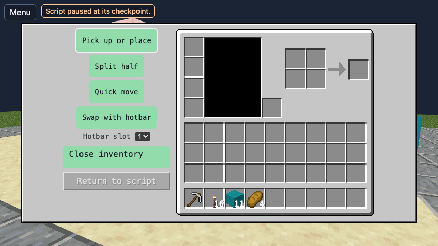

# Rosegold Viewer

**Not an official Minecraft product. Not approved by or associated with Mojang or Microsoft.**

Mount a textured web viewer on a running [Rosegold](https://github.com/RosegoldMC/rosegold.cr) bot. The bot can start headless. Open a browser later to see the terrain it loaded, its hotbar, and nearby entities. If the script permits it, take control from a keyboard or touchscreen and hand the same connection back to the script.

This is very early. The viewer grew out of a playable Minecraft Java 26.3 demo, and the rendering and control APIs will keep taking shape over the coming months.

## See it run

A script walks to a placement surface, places a cyan wool block, and hands control to an operator and back. The clip was recorded on a local vanilla server, in a desktop browser emulating a phone. It does not show a physical device or any public or shared control.

[](docs/media/mobile-demo.mp4)

[Watch the video (MP4, 12 s)](docs/media/mobile-demo.mp4) · [Download the English captions (VTT)](docs/media/mobile-demo.vtt)

Captioned in English: the script walks up to the placement surface and places a cyan wool block. Intervene becomes available at the checkpoint, the script pauses and touch controls appear. The touch stick moves the bot and a swipe turns the camera. 11 cyan wool blocks remain. Pause shows Resume script, manual control ends and the script keeps walking. One cut skips the inventory loading screen.





## Not affiliated with Minecraft

**Not an official Minecraft product. Not approved by or associated with Mojang or Microsoft.**

The code and documentation here are MIT licensed. The gameplay imagery above shows Minecraft content that belongs to its owners and is not covered by that license. See the [official Minecraft usage guidelines](https://www.minecraft.net/en-us/usage-guidelines).

## Mount it on a bot

Add the shard to your bot's `shard.yml`:

```yaml
dependencies:
  rosegold-viewer:
    github: RosegoldMC/rosegold-viewer
    version: ~> 0.1.0
```

After `shards install`, require Rosegold first. If you already have a `bot`, call `viewer = RosegoldViewer.mount(bot, pack_directory: ENV["VIEWER_PACK"])` and then `viewer.enable` when you want to attach. For a reconnecting script, keep one host outside `Bot.run` and bind each new session to it: `pack_directory` points to the **prepared textures**, not a ZIP file.

```crystal
require "rosegold/26.3"
require "rosegold-viewer"

viewer = RosegoldViewer::Host.new(pack_directory: ENV["VIEWER_PACK"])
begin
  if STDOUT.tty? && (pairing = viewer.enable)
    puts "Viewer: #{pairing.url}"
    puts "Pairing secret: #{pairing.secret}"
  end

  Rosegold::Bot.run("localhost", on_session: ->(bot : Rosegold::Bot) { viewer.bind(bot) }) do |bot|
    # Your normal bot script goes here.
    bot.wait_ticks 1_200
  end
ensure
  viewer.disable
end
```

Open the URL and enter the separate secret. The host listens on loopback by default. The example skips the listener when stdout is redirected so the secret won't end up in a log. You can also call `viewer.enable` later in the script. A read-only browser can come and go without interrupting the bot.

## Where the textures come from

Prepare a local pack from your own Minecraft Java 26.3 client JAR. You can supply a resource-pack ZIP to override the client textures. The shard does not redistribute either input. After `shards install` and [installing the pack builder prerequisites](tools/README.md#build-a-local-viewer-pack), run this from your bot project:

```sh
crystal run lib/rosegold-viewer/tools/build-pack.cr -- /path/to/26.3.jar ./viewer-pack \
  --resource-pack /path/to/resource-pack.zip
export VIEWER_PACK="$PWD/viewer-pack"
```

Leave off `--resource-pack` to use textures from the client JAR alone. Choose a new output directory; the importer won't overwrite an existing pack. Pass `VIEWER_PACK` to the process that runs your bot.

Node isn't needed on the bot: the browser app is compiled into the Crystal binary, and the host serves textures from the directory you select.

## Archived captures

You could watch the bot in a textured world before you could take control of it. The [solid-color handoff captures](docs/history/early-prototype/index.md) show a separate build used to test desktop and touch controls.
