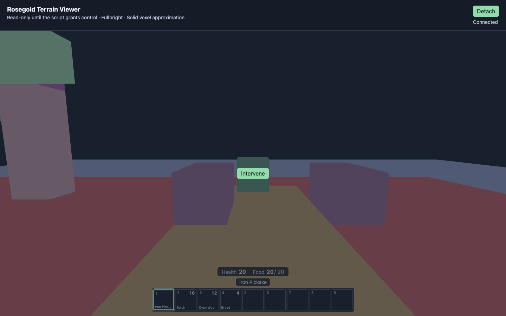
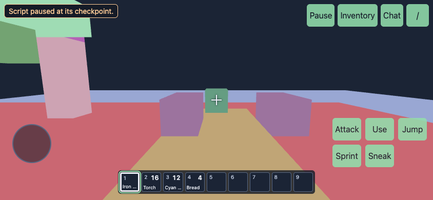

# Solid-color handoff captures

The textured viewer started in watch-only mode. Later, you could take control of the bot and hand it back to the running script. That textured demo is the basis for Rosegold Viewer 0.1.0.

These two screenshots and the clip come from a separate solid-color build. We kept them to show how the desktop and touch controls worked.

<figure>
  
  <figcaption>Desktop view in the solid-color handoff build.</figcaption>
</figure>

<figure>
  
  <figcaption>Touch controls in a desktop browser emulating a phone.</figcaption>
</figure>

## Handing the bot back

In the clip, the script walks to a corner. The operator taps **Intervene**, walks and turns, then taps **Resume script**. The bot continues along its route.

<figure>
  <video controls playsinline preload="metadata" width="960" height="540" poster="mobile-demo-poster.png" aria-label="Control handoff in the solid-color build">
    <source src="mobile-demo.mp4" type="video/mp4">
    <track kind="captions" src="mobile-demo.vtt" srclang="en" label="English" default>
  </video>
  <figcaption>Handoff recorded with the same phone emulation.</figcaption>
</figure>

[Download the early handoff video](mobile-demo.mp4) · [English captions](mobile-demo.vtt)
