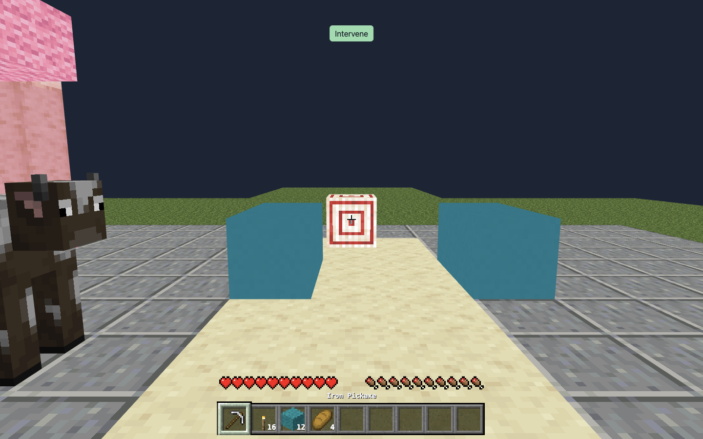
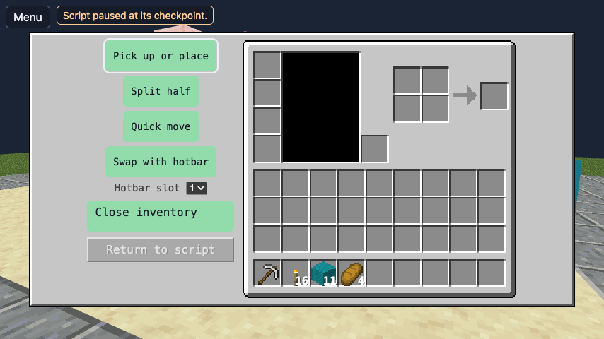

# Rosegold Viewer

Start your [Rosegold bot](https://github.com/RosegoldMC/rosegold.cr) headless and open a browser later to see the terrain it has loaded. The bot serves its own textured viewer. This site hosts the documentation.

## See it run

The clip shows a script walking to a placement surface, placing a cyan wool block, and handing control to the operator and back. It was recorded on a local vanilla server, in a desktop browser emulating a phone. It does not show a physical device or any public or shared control.

<figure>
  <video controls autoplay muted loop playsinline preload="metadata" width="854" height="480" poster="media/mobile-demo-poster.png" aria-label="Handing control to the operator and back to the script, 12 seconds">
    <source src="media/mobile-demo.mp4" type="video/mp4">
    <track kind="captions" src="media/mobile-demo.vtt" srclang="en" label="English" default>
  </video>
  <figcaption>The script walks up, places a block, and pauses at a checkpoint. Touch controls move and turn the bot, 11 cyan wool blocks remain, and Resume script hands control back. One cut skips the inventory loading screen.</figcaption>
</figure>

[Download the video (MP4, 12 s)](media/mobile-demo.mp4) · [English captions (VTT)](media/mobile-demo.vtt)

  <figure>
    
    <figcaption>Desktop observer view with the Intervene button, health, hunger and hotbar.</figcaption>
  </figure>
  <figure>
    
    <figcaption>Touch inventory while the script is paused.</figcaption>
  </figure>

The code and documentation in this repository are MIT licensed. The gameplay imagery above shows Minecraft content that belongs to its owners and is not covered by that license. See the <a href="https://www.minecraft.net/en-us/usage-guidelines">official Minecraft usage guidelines</a>.

## Get connected

1. [Add the viewer to your bot](getting-started.html) and point it at your prepared textures.
2. Open the URL printed by the bot and enter the separate pairing secret. To connect from a phone, [set up private HTTPS](private-access.html) first.
3. Watch the script run. If the script allows it, you can [take control and hand it back](controls.html) from a keyboard or touchscreen.

This is very early software for Minecraft Java 26.3, and it will keep taking shape over the coming months. [How the viewer works](architecture.html) covers what the browser renders today and where texture support is headed.
